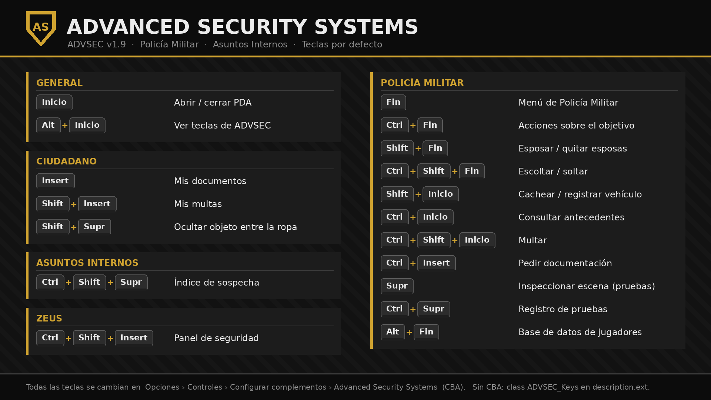

# Advanced Security Systems (ADVSEC)

**Versión 1.12.0** · Addon de Arma 3 para servidores con **Policía Militar (PM)** y **Asuntos Internos (AA.II.)**.

ADVSEC reúne en un solo mod:
- documentación de identidad;
- control de acceso (keypads, cerraduras, alarmas, CCTV);
- herramientas policiales (esposar, cachear, arrestar, multar, buscados);
- investigación forense y expedientes de Asuntos Internos;
- controles de carretera con IA;
- una base de datos de jugadores con gestión de rangos;
- un terminal de superadministrador para borrar datos y retirar rangos;
- una economía (efectivo, banco, nóminas, cajeros, tiendas y tesorería de la PM) compatible con el HUD THUD;
- sistemas de rol militar: rangos ORBAT, especialidades, servicio, despacho, alerta de base, matrículas, licencias, corrupción, K9, radar y cámara corporal.

Todo es configurable desde el editor (Eden), desde Zeus durante la partida, desde `description.ext` o desde las opciones de CBA.

> **Descarga directa:** el mod compilado y firmado está en [`release/@AdvancedSecuritySystems`](release/@AdvancedSecuritySystems). Cópialo a tu carpeta de mods de Arma 3.

## Estructura del repositorio

| Ruta | Contenido |
|---|---|
| `release/@AdvancedSecuritySystems/` | Mod compilado y listo para usar: 3 PBO firmados (el tercero, `advsec_thud`, es opcional y solo se carga con THUD), `.bisign`, `keys/*.bikey` y `mod.cpp` |
| `addons/main/` | Código fuente del sistema: SQF, configs, interfaces y texturas |
| `addons/buildings/` | Edificio de la Policía Militar: modelo, `model.cfg`, config y texturas |
| `.hemtt/project.toml` | Proyecto de compilación de [HEMTT](https://github.com/BrettMayson/HEMTT) |
| `examples/description.ext` | Plantilla de misión (ajustes, `CfgRemoteExec`, documentos propios) |
| `docs/` | Imagen de teclas y notas de versión |

### Compilar desde el código

1. Instala [HEMTT](https://github.com/BrettMayson/HEMTT) 1.x.
2. En la raíz del repositorio, ejecuta `hemtt check` para validar.
3. Ejecuta `hemtt release` para generar los PBO firmados en `.hemttout/release/`.

Cada compilación genera una clave nueva (`keys/advsec_<versión>.bikey`), que es la que debe usar el servidor.

---

## Índice
1. [Instalación](#1-instalación)
2. [Conceptos básicos](#2-conceptos-básicos)
3. [Documentación](#3-documentación)
4. [Control de acceso: keypads, cerraduras, alarmas y CCTV](#4-control-de-acceso)
5. [Policía Militar](#5-policía-militar)
6. [Evidencias y laboratorio forense](#6-evidencias-y-laboratorio-forense)
7. [Asuntos Internos](#7-asuntos-internos)
8. [Informes y expedientes](#8-informes-y-expedientes)
9. [Multas](#9-multas)
10. [Controles de carretera con IA](#10-controles-de-carretera-con-ia)
11. [Base de datos de jugadores y rangos](#11-base-de-datos-de-jugadores-y-rangos)
12. [PDA](#12-pda)
13. [Módulos de Eden y Zeus](#13-módulos-de-eden-y-zeus)
14. [Panel de seguridad de Zeus](#14-panel-de-seguridad-de-zeus)
15. [Teclas](#15-teclas)
16. [Configuración](#16-configuración)
17. [Persistencia y seguridad](#17-persistencia-y-seguridad)
18. [Interfaces (referencia)](#18-interfaces-referencia)
19. [Casos de uso](#19-casos-de-uso)
20. [Licencia](#20-licencia)

---

## 1. Instalación

### Cliente

1. Copia `@AdvancedSecuritySystems` a tu carpeta de mods.
2. Cárgalo en el lanzador como mod local.

La carpeta contiene:
- `addons\advsec_main.pbo`: todo el sistema.
- `addons\advsec_buildings.pbo`: el edificio de la PM.
- Las firmas `.bisign` de los tres PBO.
- `keys\advsec_1.12.0.bikey`.
- `mod.cpp`.

### Servidor dedicado

1. Carga el mod con `-mod=@AdvancedSecuritySystems`. No uses `-serverMod`, porque los clientes también lo necesitan.
2. Copia `keys\advsec_1.12.0.bikey` a la carpeta `keys` del servidor y borra las claves `advsec_*` antiguas. Los tres PBO están firmados, así que funciona con `verifySignatures = 2`.
3. Si la misión usa `CfgRemoteExec` en modo lista blanca, copia las clases `ADVSEC_fnc_*` del `description.ext` de ejemplo.

### Dependencias

No hay ninguna obligatoria.
- **CBA_A3 (opcional):** ajustes en *Opciones de complementos* y teclas en *Configurar complementos*.
- **ACE3 (opcional):** todas las acciones aparecen en el menú de interacción de ACE. Esposar usa las capturas de ACE. Sin ACE se usan acciones de rueda normales.
- **TFAR / ACRE (opcional):** si están cargados, la consulta a la central exige una radio de esos mods.

---

## 2. Conceptos básicos

### Requisito de acceso

Puertas, keypads, alarmas, oficinas y terminales usan el mismo modelo de requisito: `[nivel mínimo, tipos de documento, ID de llave]`.
- **Nivel mínimo (`clearance`):** de 0 a 5. Con -1 no se exige nivel.
- **Tipos de documento:** por ejemplo `MilitaryID, MPBadge`. Vacío significa cualquiera.
- **ID de llave:** una llave o tarjeta concreta que también abre.

Un documento solo vale si se lleva **el objeto físico en el inventario** y está registrado en el servidor a nombre de ese jugador. Los documentos con SteamID solo sirven a su titular.

### Cuerpos y rangos

| Cuerpo | Documento | Rangos (nivel 1-5) |
|---|---|---|
| Policía Militar | Placa PM (`MPBadge`) | Agente, Cabo, Sargento, Teniente, Capitán |
| Asuntos Internos | Credencial AA.II. (`IABadge`) | Inspector, Inspector jefe, Comisario, Comisario jefe, Director |
| Global | (base de datos) | Sin rango, Soldado … General (configurable) |

- El nivel del cuerpo es el `clearance` de la placa o credencial.
- La credencial de AA.II. también da acceso a todo lo de la PM.
- **Zeus, los administradores y el modo un jugador** tienen siempre todos los permisos.

### Permisos

Cada acción exige un cuerpo y un rango mínimo. Se cambian en `ADVSEC_Settings >> Permissions` o en CBA.

| Acción | Por defecto | Acción | Por defecto |
|---|---|---|---|
| Esposar (`restrain`) | PM 1 | Liberar (`release`) | PM 3 |
| Cachear (`search`) | PM 1 | Analizar pruebas (`evidenceAnalyze`) | PM 3 |
| Incautar (`seize`) | PM 1 | Estado de informes (`reportStatus`) | PM 3 |
| Registrar vehículos (`vehicleSearch`) | PM 1 | Revocar documentos (`revokeDoc`) | PM 4 |
| Recoger pruebas (`evidenceCollect`) | PM 1 | Anular multas (`fineCancel`) | PM 4 |
| Consultar la central (`query`) | PM 1 | Base de datos de jugadores (`playerDB`) | PM 4 |
| Multar (`fine`) | PM 2 | Rangos PM (`rankPM`) | PM 5 |
| Buscados (`wanted`) | PM 2 | Rangos globales (`rankGlobal`) | PM 5 |
| Arrestar (`arrest`) | PM 2 | Rangos AA.II. (`rankAI`) | AA.II. 5 |
| Ver sospecha (`suspicionView`) | AA.II. 1 | Cerrar expedientes (`caseClose`) | AA.II. 3 |
| Alterar pruebas (`evidenceTamper`) | AA.II. 1 | Auditoría forense (`evidenceAudit`) | AA.II. 3 |

---

## 3. Documentación

### Tipos de documento

| Tipo | Objeto | Uso |
|---|---|---|
| Pasaporte (`Passport`) | `ADVSEC_Passport` | Identidad civil |
| Identificación (`IDCard`) | `ADVSEC_IDCard` | Identidad civil |
| Permiso (`Permit`) | `ADVSEC_Permit` | Licencias y permisos |
| Tarjeta de acceso (`Keycard`) | `ADVSEC_Keycard` | Abre puertas y keypads por nivel o llave |
| Llave (`Key`) | `ADVSEC_Key` | Llave física con ID |
| ID militar (`MilitaryID`) | `ADVSEC_MilitaryID` | Automática, ligada al SteamID |
| Placa PM (`MPBadge`) | `ADVSEC_MPBadge` | Da acceso a las funciones de PM |
| Credencial AA.II. (`IABadge`) | `ADVSEC_IABadge` | Da acceso a las funciones de AA.II. y PM |

Las misiones pueden definir tipos propios en `class ADVSEC_DocumentTypes` (por ejemplo, una licencia de armas).

### Cómo se obtienen

- **ID militar automático.** Se entrega en cada aparición. Lleva nombre, rango global, unidad y SteamID.
- **Placas y credenciales automáticas.** Se entregan por SteamID según `ADVSEC_pmUIDs[]` / `ADVSEC_iaUIDs[]` o según la base de datos de jugadores.
- **Oficina de documentación.** Es un módulo que convierte un objeto en ventanilla («Emitir documento»). Abre un editor con tipo, datos, nivel y llaves, y una vista previa de la tarjeta. Cada oficina limita:
  - qué tipos puede emitir;
  - el nivel máximo;
  - quién puede operarla.
- **Zeus.** Puede emitir desde su panel la placa, la credencial, el ID militar y otros documentos.

### Interacción

- **Mis documentos** (acción propia o tecla **Insert**): lista de tus documentos para verlos.
- **Mostrar documento** (sobre otra persona): le enseñas uno de tus documentos.
- **Solicitar documentación** (sobre otra persona, o **Ctrl + Insert**): le pides que te enseñe los suyos.
- **Tarjeta del documento:** aparece en el centro de la pantalla con foto en directo del titular y sello **VÁLIDO / CADUCADO / NO COINCIDE**. La comprobación tiene en cuenta la caducidad y si el SteamID coincide con el de quien la lleva.
- **Revocar:** la PM (rango 4) puede retirar documentos.
- Los documentos se conservan entre misiones y reapariciones. Si pierdes el objeto físico, se restaura al salir del arsenal o al reaparecer.

---

## 4. Control de acceso

### Keypad

- Cualquier objeto puede ser un keypad (por defecto una tablet).
- Abre o cierra las puertas indicadas de un edificio por **PIN** o pasando una **tarjeta** que cumpla el requisito.
- El PIN nunca sale del servidor.
- Puede vincularse a una **zona de alarma** para armarla o desarmarla.

### Cerradura de puerta

- Bloquea puertas concretas (índices o `all`) de un edificio.
- Al tocar la puerta se comprueba el requisito.
- Se pueden forzar (ver Policía Militar).

### Alarma

- Tiene nombre, **zona**, radio, puertas vigiladas y un estado inicial (armada o no).
- Se dispara si, estando armada:
  - entra en el radio un jugador sin la documentación requerida; o
  - se abre una puerta vigilada.
- Suena desde el objeto (se oye a unos 400 m) y publica un aviso en el chat del sistema para todos.
- Se arma, desarma o silencia desde un keypad de su zona, con el requisito, o desde Zeus.

### CCTV

- **Cámara:** tiene nombre, red, inclinación y giro.
- **Monitor:** muestra todas las cámaras de su misma **red**.
- En el monitor:
  - **← / →** cambian de cámara;
  - **N** alterna normal, visión nocturna y térmica;
  - **Esc / Retroceso** sale.

---

## 5. Policía Militar

Para usar estas funciones hace falta placa PM, credencial AA.II., ser Zeus/admin, o llevar la PDA si `pdaGrantsAccess = 1`.

### Sobre una persona

Se accede con la interacción ACE «Policía Militar» o con **Ctrl + Fin**.
- **Esposar / quitar esposas** (**Shift + Fin**).
- **Escoltar / soltar** (**Ctrl + Shift + Fin**).
- **Meter en vehículo / sacar del vehículo.**
- **Registrar (cacheo)** (**Shift + Inicio**). Solo a una persona esposada o rendida. Se hace por zonas: manos, torso, cintura, piernas y espalda. Cada objeto escondido entre la ropa tiene una probabilidad de encontrarse (`hiddenFindChance`). Lo hallado se puede **incautar**.
- **Arrestar / encarcelar.** Pide:
  - tiempo (de 5 min a 2 h, o hasta nueva orden);
  - motivo;
  - calabozo más cercano;
  - si se genera el acta F-PM-04.

  El detenido es teletransportado y retenido hasta cumplir la condena. La condena se mantiene aunque se desconecte.
- **Poner en libertad.**
- **Declarar buscado / retirar de buscados.**
- **Multar** (**Ctrl + Shift + Inicio**).
- **Consultar antecedentes** (**Ctrl + Inicio**).
- **Solicitar documentación.**
- **Registrar incidente.**

### Propias

Se accede con el menú «Policía Militar» o con **Fin**.
- Sacar detenidos del vehículo.
- Lista de buscados.
- Archivo de informes.
- Registrar incidente.
- Consulta a la central.
- Inspeccionar escena (**Supr**).
- Registro de pruebas (**Ctrl + Supr**).
- Base de datos de jugadores (**Alt + Fin**).
- Registrar el vehículo cercano.

### Vehículos

- **Registro por compartimentos:** guantera, bajo los asientos y maletero.
- **Doble fondo:** cualquier jugador puede esconder objetos en los bajos del vehículo. El escondite se guarda solo en el servidor y la PM lo encuentra con una probabilidad configurable (`stashFindChance`).
- Lo encontrado se puede incautar.

### Ciudadanos

- **Ocultar objeto entre la ropa** (**Shift + Supr**): esconde un objeto pequeño del uniforme o chaleco.

### Forzar cerraduras

- Se hace con la herramienta configurada (`ToolKit` por defecto) durante `breachTime` segundos.
- El servidor cronometra el forzado y comprueba la distancia.

### Buscados y consulta a la central

- **Lista de buscados:** persistente, con motivo, nivel y agente que lo declaró.
- **Consulta a la central:** desde la PDA o con tecla, sobre la persona apuntada o eligiéndola en una lista.
  - Necesita radio si `queryNeedsRadio = 1`.
  - Tarda `queryDelay` segundos.
  - Devuelve documentos, requisitorias, multas, arrestos e informes. Si consulta AA.II., también los expedientes.

---

## 6. Evidencias y laboratorio forense

### Tipos de prueba

Las pruebas se generan solas:
- **Casquillos:** uno cada `casingEvery` disparos. Llevan arma, munición y número de serie.
- **Huellas:** al tocar puertas, vehículos y contenedores (`printChance`). Con guantes la probabilidad baja a `gloveChance`.
- **Sangre:** al resultar herido alguien.

### Flujo de trabajo

1. **Inspeccionar escena** (**Supr**): marca las pruebas en un radio de `sceneRadius`.
2. **Recoger:** la prueba pasa a una **bolsa de pruebas** (`ADVSEC_EvidenceBag`) bajo tu custodia.
3. **Registro de pruebas** (**Ctrl + Supr**): panel con tus pruebas, su detalle y la **cadena de custodia** (quién la tuvo y cuándo). Desde aquí se **transfieren** a otro agente.
4. **Laboratorio forense** (módulo): **analizar** una prueba tarda `labTime` segundos y revela su origen, es decir, el arma o la persona a la que corresponde.

Las pruebas sin recoger desaparecen tras `evidenceTTL` segundos.

### Intervención de AA.II.

- Puede **alterar** pruebas (`evidenceTamper`), algo pensado para el rol de corrupción e investigación interna.
- También puede hacer una **auditoría forense** con barra de progreso (`auditTime`) que descubre las manipulaciones.

---

## 7. Asuntos Internos

### Índice de sospecha

- Cada agente acumula puntos por conductas irregulares (`Rules`):

| Conducta | Puntos |
|---|---|
| Esposar sin causa | 8 |
| Encarcelar sin causa | 15 |
| Encarcelar sin acta | 10 |
| Herir a un esposado | 25 |
| Liberación anticipada | 10 |
| Retirar un buscado ajeno sin informe | 5 |
| Investigador que consulta su propio caso | 20 |
| Manipulación de prueba | 40 |
| Anular una multa ajena | 5 |

- Los puntos bajan con el tiempo (`heatDecay`).
- Al superar `heatThreshold` se abre automáticamente un **expediente F-AI-01**.
- **Panel de sospecha** (**Ctrl + Shift + Supr**): agentes con indicios, eventos recientes, botones «Abrir expediente» y «Archivar índice».
- Los expedientes, la auditoría y el cierre de casos van por rango de AA.II.

---

## 8. Informes y expedientes

Los formatos siguen el *Manual Maestro PM / AA.II.*:

| PM | AA.II. |
|---|---|
| F-PM-01 Parte de novedades | F-AI-01 Apertura de expediente |
| F-PM-02 Denuncia o queja | F-AI-02 Acta de declaración |
| F-PM-03 Evidencias y cadena de custodia | F-AI-03 Pliego de cargos |
| F-PM-04 Acta de detención | F-AI-04 Acta de audiencia |
| | F-AI-05 Resolución |
| | F-AI-06 Recurso |
| | F-AI-07 Informe trimestral |

- Se acceden desde el **terminal de informes** (módulo), la PDA o la acción propia «Informes PM / AA.II.».
- **Editor con plantilla** por formato.
- **Archivo** con búsqueda, filtros por departamento y estado, notas añadidas y cambio de estado (`reportStatus`).
- Los informes de AA.II. solo los ve AA.II.
- Al arrestar se genera el F-PM-04 automáticamente si se marca.

---

## 9. Multas

- **Poner una multa:** importe y motivo. Se registra con número, agente y fecha.
- **Mis multas** (**Shift + Insert**): cualquier jugador ve su historial y paga.
  - Con la economía activada (por defecto) se cobra del efectivo y, si no llega, del banco. El dinero va a la tesorería de la PM.
  - «Marcar pagada» (agente) cobra al sancionado si está conectado.
  - Sin economía: si `moneyVar` apunta a la variable de dinero de la misión se cobra de ahí; si no, un agente la marca como pagada.
- **Anular** exige rango (`fineCancel`) y anular una multa ajena suma sospecha.
- Con `fineWantedThreshold > 0`, quien deba esa cantidad pasa automáticamente a buscados.

### Economía

Activa por defecto (`economy = 1`). Funciona en cualquier misión y es compatible con el HUD **THUD Antistasi** aunque no se juegue Antistasi.

**Dinero**
- Cada jugador (por SteamID) tiene **efectivo** y **banco**. Las cuentas nuevas reciben `startCash` y `startBank`.
- **Cartera y banco** (**Alt + Insert** o acción propia): saldo, últimos 40 movimientos y botones Ingresar, Retirar, Transferir y Dar efectivo.
- Ingresar, retirar y transferir exige estar junto a un **cajero** (módulo «Cajero automático»), salvo con `atmAnywhere = 1`.
- Dar efectivo: a otra persona a menos de 5 m.

**Nóminas**
- Cada `salaryInterval` minutos se ingresa en el banco: `salaryBase` + plus por nivel PM (`salaryPM[]`) + plus por nivel AA.II. (`salaryAI[]`) + `salaryGlobalStep` por escalón de rango global.
- Con `salaryFromTreasury = 1` las paga la tesorería de la PM.

**Tiendas**
- Módulo «Tienda» sobre una mesa, un mostrador o un PNJ. Artículos `clase:precio, ...` o, vacío, la lista `shopItems[]`.
- Comprar 1 o 5 (efectivo y, si falta, banco). Lo comprado va al uniforme, chaleco o mochila; si no cabe, al suelo.
- Vender uno: devuelve `sellFactor` del precio.

**Tesorería de la PM**
- Recibe las multas (`fineToTreasury`) y, opcionalmente, las compras (`shopToTreasury`).
- Con permiso `treasury` (PM nivel 5) se consulta y se pagan primas a agentes.

**Superadministrador:** categoría «Economía» del terminal: sumar o restar dinero, poner a cero, borrar cuentas y fijar la tesorería.

**HUD THUD**

| Línea del HUD | Qué muestra con ADVSEC |
|---|---|
| Dinero | Efectivo del jugador (variable `moneyX`) |
| Tesorería | Tesorería de la PM (`resourcesFIA`). THUD solo la enseña al «jefe» salvo que lo cambies en su menú |
| Jefe | Agente PM de mayor rango conectado (`theBoss`) |
| ЛР / HR | Agentes PM conectados (`hr`) |
| Rango | Rango de Arma, que ADVSEC fija con el rango global |

- Fuera de Antistasi, ADVSEC desactiva la espera de THUD por Antistasi y llama «PM» a la tesorería (`thudTreasuryName`). Las líneas propias de Antistasi (nivel de guerra, agresión...) se pueden ocultar en el menú de THUD.
- **En Antistasi** el efectivo (`moneyX`) es de Antistasi. ADVSEC lo usa tal cual y solo añade banco, nóminas, cajeros y tiendas; no toca `resourcesFIA`, `hr` ni `theBoss`.

### Rol militar (1.12)

**Rangos (toda la tropa).** `ranksGlobal[]` pasa a la jerarquía Rct., Sdo., Sdo 1º. (Tropa) · Cbo., Cbo 1º., Cbo M., Sgt., Sgt 1º., Sgt M. (Suboficial) · Brig., Tte., Cap. (Oficial). Se asignan en la base de datos de jugadores. El rango exacto lo lleva ADVSEC (`class ADVSEC_Ranks`); el de Arma (`ranksGlobalArma`) se fija con `setUnitRank` y THUD muestra el escalón (Tropa, Cabo, Sargento, Brigada, Teniente, Capitán) gracias a `advsec_thud.pbo`. *Los índices antiguos (15 rangos) cambian de nombre: revisa los rangos globales ya asignados.* El `description.ext` de ejemplo incluye un `CfgORBAT`.

**Especialidades (metopas).** JTAC, RO, Sanitario, Médico, AT, Ametrallador, Ingeniero, EOD, AA, Granadero, Carrista, Paracaidista, Piloto, Logística, Artillería y Tirador (`class ADVSEC_Specialties`).
- **Ctrl + Alt + Inicio** o acción propia «Especialidades»: lista, solicitar ingreso y darse de baja.
- **PDA de la metopa** (la misma para todas, parametrizada): miembros, solicitudes, aceptar, rechazar o dar de baja, añadir jugador. La gestionan sus **encargados**; los nombra un superadministrador.
- Rasgos automáticos: Sanitario y Médico (`Medic`, ACE `medicClass` 1 y 2), Ingeniero y Logística (`Engineer`), EOD (`ExplosiveSpecialist`, ACE EOD).

**Servicio y despacho**
- Fichar entrada y salida (menú PM o módulo «Terminal de fichaje»; `dutyAnywhere`). Se guardan las horas; el plus PM/AA.II. de la nómina solo se cobra de servicio (`salaryDutyOnly`). De servicio se enciende la **cámara corporal**.
- **112**: cualquiera llama (acción propia). El aviso va a la patrulla de servicio más cercana (o a toda la PM) con marca en el mapa. **Botón de pánico**: **Alt + Supr**. **Central de despacho**: **Ctrl + Alt + Insert**.

**AA.II.**
- **Suspensión temporal**: retira rangos PM, AA.II. y global durante X horas de reloj real y los devuelve solos.
- **Auditoría bancaria**: movimientos sospechosos (agentes implicados o ≥ `suspiciousAmount`), historial de cualquier cuenta y **congelación** (la cuenta congelada solo usa efectivo).
- **Cámaras corporales**: lo que hace un agente con la cámara encendida queda grabado. Apagarla de servicio suma sospecha.

**Base, vehículos y licencias**
- **Nivel de alerta** (verde, amarillo, rojo): amarillo arma las alarmas; rojo además cierra las puertas controladas y los keypads piden documento. THUD lo muestra en la línea de nivel (`tierWar`).
- **Concesionario**: vehículos matriculados a tu nombre y cerrados (acción «Abrir / cerrar mi vehículo»). «Mis vehículos»: denunciar robo, que lo pone en buscados. La PM consulta matrículas.
- **Licencias** de armas, conducir y piloto en la oficina de documentación, con tasa a la tesorería. La PM puede retirarlas. Con licencia de armas se **registran las armas**: el casquillo analizado en el laboratorio da el titular registrado; un arma sin registrar no identifica a nadie (`weaponRegistryStrict`).
- **Fianza**: el detenido paga `bailPerMinute` × minutos pendientes y sale.

**Corrupción, mercado negro y apoyo**
- «Ofrecer dinero» a un agente: si acepta, el movimiento queda marcado como soborno para AA.II.
- **Mercado negro**: tienda oculta (opción del módulo Tienda) con `blackMarketItems[]`.
- **K9** (menú PM): llamar al perro y olfatear vehículos o personas; lo marcado aparece seguro en el registro.
- **Radar**: apunta a un vehículo; si supera `speedLimit`, multa directa al conductor.
- **Discord**: `discordWebhook` + una extensión de servidor (`discordExtension`) envía detenciones, buscados, fianzas, suspensiones, alertas, pánicos y robos.

---

## 10. Controles de carretera con IA

### Colocación

- El módulo **Control de carretera (IA)** se coloca en la carretera.
- Si no tiene unidades sincronizadas, crea sus propios agentes (`checkpointUnits`, clases de Gendarmería) y conos.

### Secuencia con cada vehículo

1. **Detención (siempre).** Para a **todos** los vehículos que entran en el radio, el 100% de las veces. Aparece el aviso **ALTO** en pantalla y el vehículo se frena.
2. **Petición de documentación.** Un agente camina hasta la ventanilla del conductor y abre el diálogo **«Mostrar documentación» / «Negarse»**.
3. **Revisión de papeles.** Barra de progreso de `checkpointPapersTime` segundos. Valen los documentos de `checkpointDocs`.
4. **Registro del vehículo.** Un segundo agente va a la parte trasera con animación de registro. Barra de `checkpointVehicleTime` segundos, con probabilidad `checkpointSearchChance`.
5. **Resultado:**

| Situación | Consecuencia |
|---|---|
| Todo en regla | El vehículo puede seguir |
| Sin documentación válida | Multa (`checkpointFine`) |
| Objetos de `illegalItems` | Multa o detención |
| Negarse, o no responder en 40 s | Arresto por «Negarse a identificarse» |

- Para retirar el control, se borra el módulo (o su helipuerto invisible).
- `checkpointExemptPM = 1` deja pasar a la PM, a los admins y a Zeus.

---

## 11. Base de datos de jugadores y rangos

Novedad de la versión 1.9.

### Registro

Se apunta automáticamente a todo jugador que entra en el servidor:
- nombre y nombres anteriores;
- SteamID;
- primera y última conexión;
- número de conexiones y tiempo jugado;
- rangos;
- notas;
- historial de cambios.

### Panel

- Se abre con **Alt + Fin**, desde el menú PM o desde la acción ACE.
- Lista con indicador en línea (verde) y rangos de cada jugador.
- Buscador por nombre o SteamID, y filtros: todos, en línea, PM, AA.II. y con rango global.
- Ficha detallada con historial.

### Gestión de rangos

| Rango | Opciones |
|---|---|
| PM | «Según lista de la misión», «Sin rango» (retira la placa) o nivel 1-5 |
| AA.II. | Igual que PM |
| Global | Lista `ranksGlobal` |

- El rango global se ve en el ID militar y en la PDA, y cambia el rango de Arma (`ranksGlobalArma`, se desactiva con `globalRankSetUnit = 0`).
- Los cambios se aplican **al momento** si el jugador está conectado (recibe o pierde la placa y un aviso). Si no, se aplican cuando vuelva a aparecer.
- Reglas para gestionar rangos:
  - un mando solo gestiona rangos PM/AA.II. **inferiores al suyo**;
  - nadie puede cambiar su propio rango;
  - Zeus y los administradores no tienen límite.
- Cada cambio queda en el historial y en el registro de eventos.

### Terminal de superadministrador

Panel de administración total de la PM y AA.II. Pensado para el mando o el staff del servidor.

**Quién puede abrirlo**
- Zeus y los administradores del servidor, siempre.
- Los SteamID de `superAdmins[]` en `class ADVSEC_Settings` de la misión.
- Los jugadores a los que un superadministrador da acceso desde el propio terminal. Esa lista se guarda en el perfil del servidor.

**Cómo se abre**
- **Ctrl + Alt + Fin**.
- Acción propia «Terminal de superadministrador» (ACE o rueda), visible solo para superadministradores.
- Un ordenador con el módulo «Terminal de superadministrador» (Eden o Zeus).

**Qué permite**

| Categoría | Acciones |
|---|---|
| Informes y expedientes | Borrar uno · borrar todos |
| Jugadores y rangos | Quitar sus rangos (PM, AA.II. y global) · volver a los rangos de la misión · dar o quitar superadmin · borrar la ficha · quitar rangos a todos |
| Superadministradores | Ver la lista y quitar accesos |
| Buscados | Retirar una requisitoria · vaciar la lista |
| Detenidos | Liberar a uno · liberar a todos |
| Multas | Borrar una · borrar todas |
| Pruebas | Borrar una · borrar todas |
| Sospecha (AA.II.) | Archivar un índice · archivar todos |
| Documentos | Retirar los documentos de un titular · de todos |
| Registro de eventos | Vaciarlo |

- Las acciones destructivas piden **doble pulsación** en 4 segundos («¿Seguro? Pulsa otra vez»).
- Los rangos retirados se aplican al momento si el jugador está conectado: pierde la placa y el rango de Arma.
- Todo lo hace el servidor, que vuelve a comprobar el acceso. Cada acción queda en el registro de eventos como `superAdmin` (salvo el propio vaciado, que deja una única entrada nueva).

---

## 12. PDA

Hay dos objetos: **PDA de Policía Militar** (`ADVSEC_PDA_PM`) y **PDA de Asuntos Internos** (`ADVSEC_PDA_AI`). Se abren y cierran con **Inicio**.

- **Pestañas:** Inicio, Informes / Expedientes, Denuncias y Buscados.
- **Accesos directos de PM:** consulta central, nuevo informe, denuncias, registro de pruebas, buscados y mis documentos.
- **Accesos directos de AA.II.:** abrir expediente, índice de sospecha, expedientes, consulta central, pruebas y buscados.
- La cabecera muestra rango, nombre, unidad, posición, fecha y hora.
- Sin placa o credencial la PDA queda bloqueada, salvo con `pdaGrantsAccess = 1`.

---

## 13. Módulos de Eden y Zeus

Todos están en la categoría **Advanced Security**.

### Cómo se colocan

- **En Eden:** sincroniza el módulo con un objeto o edificio. Si no sincronizas nada, el módulo crea su propio objeto: TV, portátil, mesa, tablet o altavoces.
- **En Zeus:** suelta el módulo **sobre** el objeto. Funciona también con edificios del mapa no editables, y se confirma con «Módulo sobre: X». Si lo sueltas en el suelo crea el objeto. Aparece un cuadro de diálogo con las mismas opciones que en Eden.

Los módulos funcionan con jugadores que entran a mitad de partida, y reaplicarlos sustituye la configuración anterior sin duplicar acciones.

### Lista de módulos

| Módulo | Qué hace | Opciones principales |
|---|---|---|
| Cámara CCTV | Cámara en un objeto | Nombre, red, inclinación, giro |
| Monitor CCTV | Ver cámaras de una red | Red |
| Keypad / control de acceso | PIN o tarjeta para puertas | PIN, puertas, zona de alarma, etiqueta, requisito |
| Cerradura de puerta | Bloquear puertas | Puertas, bloqueada al inicio, requisito |
| Alarma | Detección de intrusos | Nombre, zona, radio, puertas vigiladas, armada, requisito |
| Oficina de documentación | Emitir documentos | Emisor, tipos, nivel máximo, requisito del operador |
| Terminal de informes | Acceso a informes | Departamento (PM / AA.II. / ambos) |
| Calabozo | Centro de detención | Nombre, radio |
| Laboratorio forense | Analizar pruebas | Nombre |
| Control de carretera (IA) | Checkpoint automático | Nombre, agentes, radio |
| Terminal de superadministrador | Administración total (borrados y rangos) | Nombre (Zeus) |
| Cajero automático | Ingresar, retirar y transferir | Nombre |
| Tienda | Comprar y vender (o mercado negro) | Nombre, artículos `clase:precio`, oculta |
| Concesionario de vehículos | Vender vehículos matriculados | Nombre, vehículos `clase:precio` |
| Terminal de fichaje | Fichar entrada y salida de servicio | |
| Panel de seguridad (solo Zeus) | Abre el panel de Zeus | |
| Acciones de PM sobre unidad (solo Zeus) | Menú policial sobre la unidad | |

---

## 14. Panel de seguridad de Zeus

Se abre con **Ctrl + Shift + Insert** o con el módulo. Solo lo pueden usar Zeus o los administradores.

- **Objetos de seguridad**, con filtro por tipo:
  - Ir a.
  - Abrir / cerrar puertas.
  - Cambiar PIN.
  - Ver cámara.
  - Armar, desarmar, disparar o silenciar alarmas.
- **Jugadores:**
  - Ir a.
  - Acciones PM.
  - Encarcelar / liberar.
  - Dar placa PM, credencial AA.II. o ID militar.
  - Ver documentos.
  - Marcar como buscado o no.
  - Registrar un incidente.
- Con la interfaz de Zeus abierta, se ven iconos 3D sobre los objetos de seguridad.

---

## 15. Teclas

Con CBA se cambian en *Opciones › Controles › Configurar complementos › Advanced Security Systems*. Sin CBA se cambian con `class ADVSEC_Keys` en `description.ext`.

| Tecla | Acción | Tecla | Acción |
|---|---|---|---|
| Inicio | Abrir / cerrar PDA | Shift + Inicio | Cachear / registrar vehículo |
| Alt + Inicio | Ver teclas | Ctrl + Inicio | Consultar antecedentes |
| Insert | Mis documentos | Ctrl + Shift + Inicio | Multar |
| Shift + Insert | Mis multas | Ctrl + Insert | Pedir documentación |
| Shift + Supr | Ocultar objeto | Supr | Inspeccionar escena |
| Fin | Menú PM | Ctrl + Supr | Registro de pruebas |
| Ctrl + Fin | Acciones sobre el objetivo | Alt + Fin | Base de datos de jugadores |
| Shift + Fin | Esposar / quitar | Ctrl + Shift + Supr | Índice de sospecha (AA.II.) |
| Ctrl + Shift + Fin | Escoltar / soltar | Ctrl + Shift + Insert | Panel de seguridad (Zeus) |
| Ctrl + Alt + Fin | Terminal de superadministrador | Alt + Insert | Cartera y banco |
| Alt + Supr | Botón de pánico | Ctrl + Alt + Insert | Central de despacho |
| Ctrl + Alt + Inicio | Especialidades (PDA de metopa) | | |

---

## 16. Configuración

### Prioridad

**CBA (en partida) > `description.ext` de la misión > valores del addon.** Solo hace falta escribir lo que quieras cambiar.

### Variables de misión (`description.ext`)

| Variable | Defecto | Descripción |
|---|---|---|
| `ADVSEC_persist` | 1 | Guardar datos en el perfil del servidor |
| `ADVSEC_saveInterval` | 60 | Segundos entre guardados |
| `ADVSEC_logMax` | 5000 | Tamaño del registro de eventos |
| `ADVSEC_autoMilitaryID` | 1 | Entregar el ID militar automático |
| `ADVSEC_militaryIssuer` / `ADVSEC_militaryClearance` | | Emisor y nivel del ID militar |
| `ADVSEC_pmUIDs[]` / `ADVSEC_iaUIDs[]` | | Placas por SteamID: `"uid"` o `{"uid", nivel}` |
| `ADVSEC_reportKey` | | Nombre del archivo del servidor. La misma clave comparte los datos entre misiones |
| `ADVSEC_breachItem` / `ADVSEC_breachTime` | ToolKit / 20 | Forzar cerraduras |
| `ADVSEC_pdaGrantsAccess` | 0 | Con 1, llevar la PDA basta para acceder |
| `ADVSEC_reportsSelfAction` | 1 | Acción propia de informes |

### `class ADVSEC_Settings`

- **Rangos:** `ranksPM[]`, `ranksAI[]`, `ranksGlobal[]`, `ranksGlobalArma[]`, `globalRankSetUnit`.
- **Superadministradores:** `superAdmins[] = {"7656119..."};`.
- **Economía:** `economy`, `startCash`, `startBank`, `treasuryStart`, `salaryInterval`, `salaryBase`, `salaryPM[]`, `salaryAI[]`, `salaryGlobalStep`, `salaryFromTreasury`, `fineToTreasury`, `shopToTreasury`, `sellFactor`, `atmAnywhere`, `shopItems[]`, `thudCompat`, `thudTreasuryName`.
- **Permisos:** `class Permissions { accion[] = {"PM"|"AI", nivel}; }`.
- **Evidencias:** `evidenceTTL`, `casingEvery`, `printChance`, `gloveChance`, `gloveItems[]`, `labTime`, `auditTime`, `sceneRadius`.
- **Sospecha:** `heatThreshold`, `heatDecay`, `class Rules`.
- **Registros:** `hiddenFindChance`, `stashFindChance`.
- **Central:** `queryNeedsRadio`, `queryDelay`.
- **Multas:** `currency`, `moneyVar`, `fineWantedThreshold`.
- **Checkpoint:** `illegalItems[]`, `checkpointFine`, `checkpointSearchChance`, `checkpointPapersTime`, `checkpointVehicleTime`, `checkpointUnits`, `checkpointUnitClasses[]`, `checkpointSide`, `checkpointExemptPM`, `checkpointDocs[]`.

### CBA

En *Opciones de complementos › Advanced Security Systems* hay 9 secciones: General, Documentos, Policía Militar, Rangos y permisos, Evidencias, Sospecha, Multas, Checkpoint y Economía. Son ajustes globales, que fija el servidor o el administrador.

---

## 17. Persistencia y seguridad

### Persistencia

- Todo se guarda en el **perfil del servidor** bajo `ADVSEC_reportKey`:
  - informes;
  - detenidos;
  - buscados;
  - documentos;
  - evidencias;
  - sospecha;
  - multas;
  - jugadores;
  - registro de eventos.
- Se guarda cada `saveInterval` segundos y al acabar la misión. Usar la misma clave en varias misiones comparte los datos.

### Seguridad

- **Servidor como autoridad.** Toda acción se valida en el servidor: quién llama, distancia, rango y permisos. Los clientes no pueden emitir documentos, cambiar rangos ni reconfigurar cerraduras.
- **Inicializaciones protegidas.** Las de objetos solo se aceptan si vienen del servidor o de un Zeus/administrador.
- **Registro de eventos de auditoría.** Guarda arrestos, emisiones, cambios de rango, manipulaciones, etc., con fecha, autor, SteamID y posición. También se escribe en el `.rpt` del servidor.
- **Lista blanca.** La plantilla `CfgRemoteExec` añade una capa extra.

---

## 18. Interfaces (referencia)

| Interfaz | Se abre con |
|---|---|
| Tarjeta de documento (centro de pantalla) | Ver o mostrar un documento |
| Editor de documentos con vista previa | Oficina de documentación |
| Keypad numérico | Keypad |
| Vista CCTV con HUD | Monitor |
| PDA PM / AA.II. | Inicio |
| Editor y archivo de informes | PDA, terminal o acción propia |
| Panel genérico (lista + detalle + botones): buscados, pruebas, sospecha, multas, consulta | Varias |
| Cacheo por zonas | Cachear |
| Registro de vehículo | Registrar vehículo |
| Base de datos de jugadores | Alt + Fin |
| Panel de seguridad de Zeus | Ctrl + Shift + Insert |
| Aviso ALTO y diálogo del control | Checkpoint |
| Barra de progreso (auditoría, papeles, registro) | Automática |
| Formularios de Zeus | Módulos y acciones (arresto, multa…) |

---

## 19. Casos de uso

- **Base militar con acceso controlado.**
  - Coloca keypads con requisito `MilitaryID` en la entrada, cerraduras de nivel 3 en la armería y una alarma con zona vinculada al keypad.
  - Pon cámaras con red `base` y un monitor en la sala de guardia.
- **Comisaría de la PM.**
  - Usa el edificio incluido (`advsec_buildings`) con un terminal de informes, un calabozo, un laboratorio y una oficina de documentación.
  - Da placas desde la base de datos de jugadores.
- **Patrulla y tráfico.**
  - Pon controles de carretera con IA en los accesos. La PM consulta antecedentes desde la PDA, multa y declara buscados.
- **Investigación criminal.**
  - Tras un tiroteo: inspeccionar la escena, recoger casquillos y huellas, analizar en el laboratorio, consultar antecedentes, arrestar con acta F-PM-04.
- **Asuntos Internos.**
  - Vigila el índice de sospecha. Al abrirse un F-AI-01 automático, audita las pruebas, toma declaración (F-AI-02) y resuelve (F-AI-05).
- **Zeus en directo.**
  - Suelta módulos sobre edificios del mapa para improvisar instalaciones seguras.
  - Gestiona alarmas y detenidos desde el panel de seguridad.

---

## 20. Licencia

**Advanced Security Systems** © 2026 IosifStalin6773 se distribuye bajo la licencia **[Creative Commons Atribución-NoComercial-SinDerivadas 4.0 Internacional (CC BY-NC-ND 4.0)](https://creativecommons.org/licenses/by-nc-nd/4.0/deed.es)**.

- ✅ **Puedes** usarlo libremente en tus servidores y misiones, y compartirlo y redistribuirlo tal cual, citando al autor y enlazando la licencia.
- ❌ **No puedes** usarlo con fines comerciales: venderlo, cobrar por acceder a él ni incluirlo en servidores o paquetes de pago.
- ❌ **No puedes** distribuir versiones modificadas ni obras derivadas: repacks, partes del código en otros mods, traducciones publicadas, etc.

Configurar el mod desde la misión (`description.ext`, CBA, módulos de Eden/Zeus) es usarlo, no modificarlo, y está permitido.

El texto legal completo está en [`LICENSE`](LICENSE).
